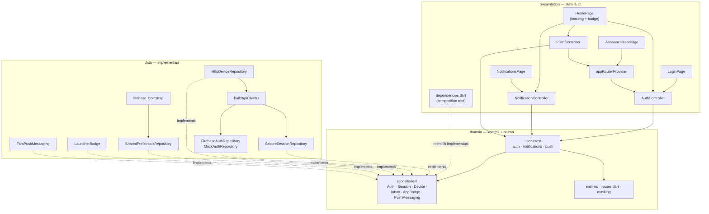
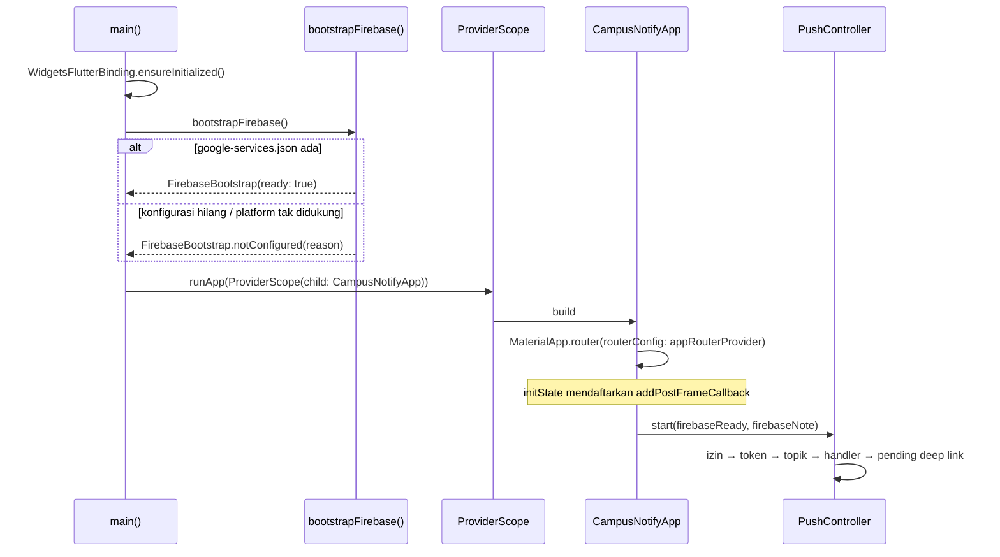
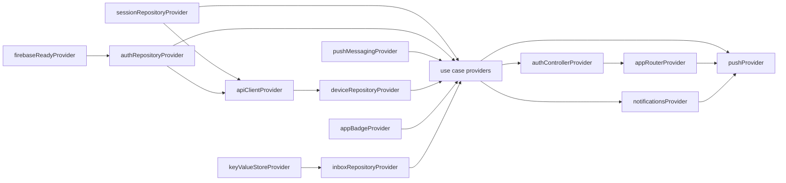
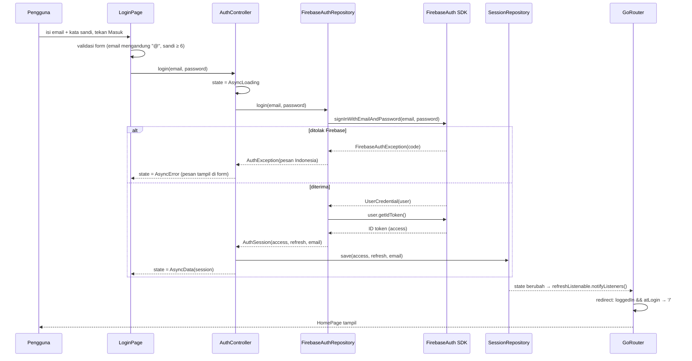
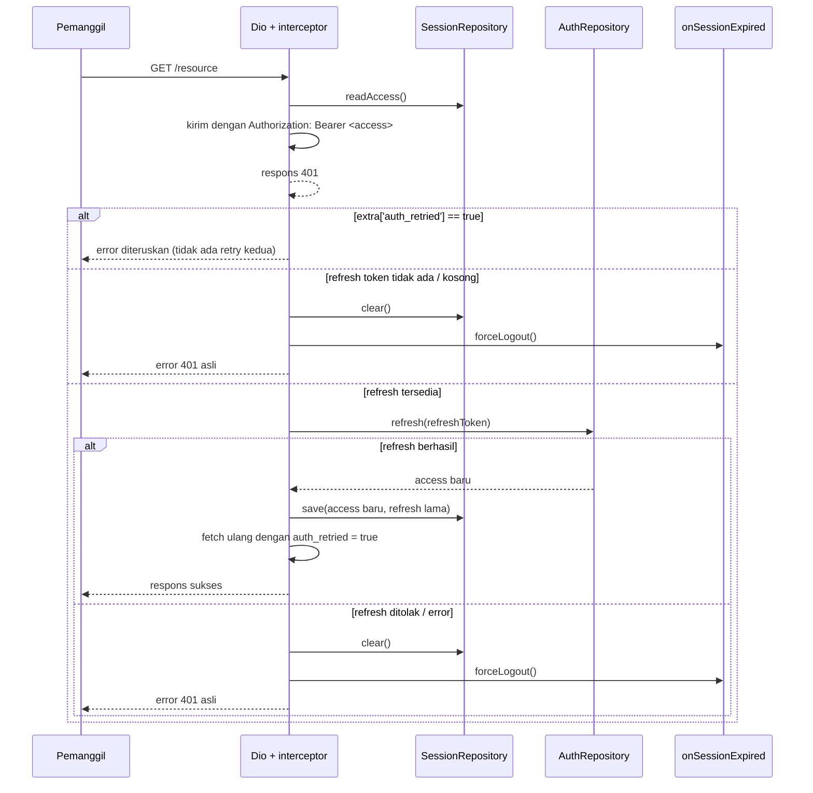
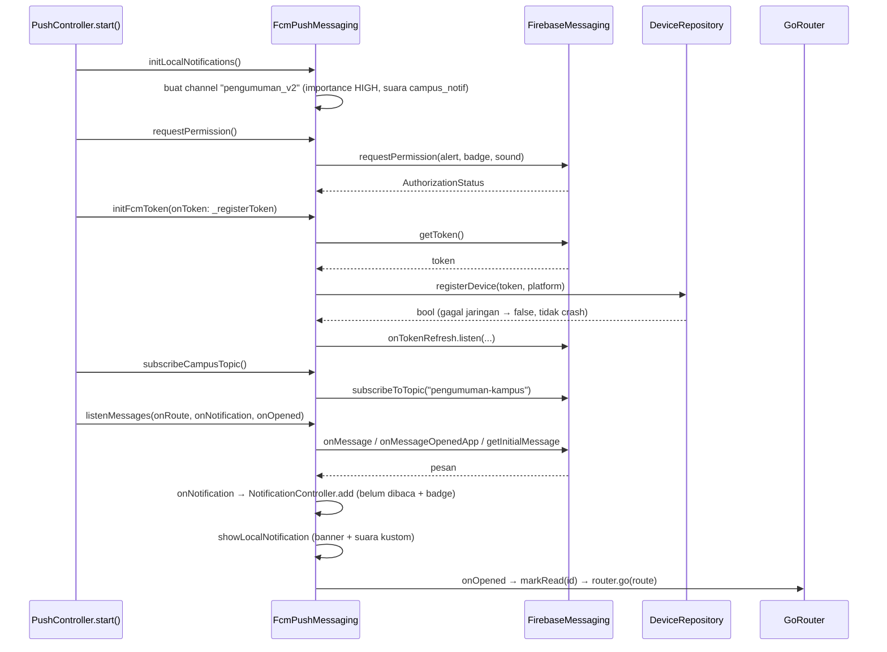
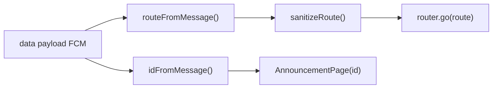
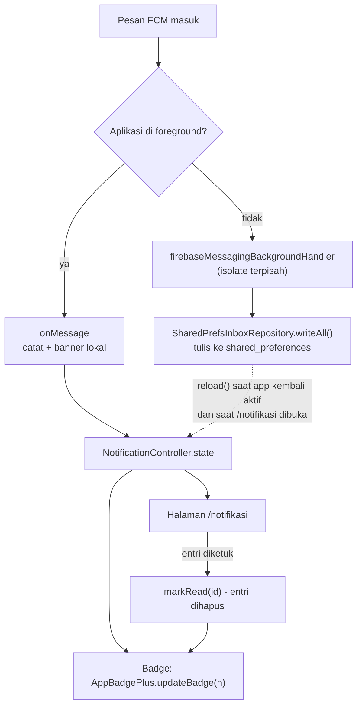
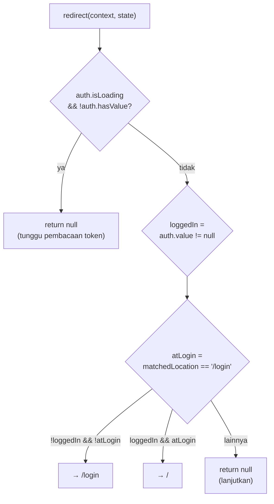

# Arsitektur Campus Notify

Dokumen ini menjelaskan bagaimana bagian-bagian aplikasi tersusun dan bagaimana
data bergerak di antaranya. Untuk kontrak fungsi per berkas, lihat
[`referensi-kode.md`](referensi-kode.md); untuk cara mengubah kode, lihat
[`panduan-pengembangan.md`](panduan-pengembangan.md).

## 1. Tujuan arsitektur

Aplikasi ini kecil, tetapi menggabungkan empat hal yang mudah saling
mengganggu: penyimpanan rahasia, klien HTTP dengan retry, navigasi berbasis
rute, dan pesan yang datang dari luar proses aplikasi. Karena itu batasannya
dibuat tegas:

| Batasan | Konsekuensi desain |
|---|---|
| Token tidak boleh bocor ke log, UI, atau `SharedPreferences` | Hanya `SecureSessionRepository` yang menyentuh `flutter_secure_storage`; semua tampilan token lewat `maskSecret()` |
| Navigasi tidak boleh bergantung pada `BuildContext` dari lapisan non-UI | `PushMessaging` menerbitkan rute sebagai `String`; navigasi dijalankan `PushController` lewat `GoRouter` global |
| Kode yang bergantung platform harus bisa diuji | `domain/` hanya berisi Dart murni; pemetaan payload jadi fungsi murni di `data/messaging/fcm_mapper.dart`; semua kontrak bisa di-*override* di test |
| Aplikasi harus tetap hidup tanpa Firebase | `bootstrapFirebase()` menangkap kegagalan dan melaporkannya sebagai status, bukan crash |
| Satu sumber kebenaran untuk path | Semua path berasal dari `Routes` di `lib/domain/routes.dart` |

## 2. Peta lapisan

Aturan arah dependency: **presentation → domain ← data**.

- `domain/` tidak meng-import Flutter, Firebase, Dio, atau Riverpod. Semua
  dependensi luar berbentuk `abstract interface class` di
  `domain/repositories/`.
- `presentation/` tidak meng-import SDK apa pun; ia hanya menyentuh `domain/`
  dan `dependencies.dart`.
- `data/` meng-import `domain/` (untuk mengimplementasikan kontrak), tidak
  sebaliknya. Tidak ada satu pun berkas `data/` yang meng-import
  `presentation/`.

## 3. Bootstrap dan siklus hidup

Dua detail yang mudah salah dan sengaja ditangani:

1. **`bootstrapFirebase()` di-`await` sebelum `runApp`.** FCM memerlukan
   instance Firebase yang sudah siap; tanpa itu `getToken()` gagal.
2. **`PushController.start()` ditunda satu frame.** `getInitialMessage()`
   (notifikasi yang membuka aplikasi dari terminated) bisa selesai lebih cepat
   daripada `GoRouter` terpasang. `addPostFrameCallback` memastikan router sudah
   ada sebelum navigasi pertama dijalankan.

## 4. Graf dependency provider

Semua provider didefinisikan di `lib/presentation/providers/dependencies.dart`
(kecuali controller dan router). Tidak ada provider yang dibuat di dalam widget.

| Provider | Tipe | Isi | Bisa di-*override* saat test |
|---|---|---|---|
| `firebaseReadyProvider` | `Provider<bool>` | Hasil `bootstrapFirebase()`; default `false` | Ya — di-`main()` dan di test |
| `sessionRepositoryProvider` | `Provider<SessionRepository>` | Satu-satunya akses ke secure storage | Ya — dipakai `test/auth_test.dart`, `test/api_client_test.dart`, `test/notification_test.dart` |
| `authRepositoryProvider` | `Provider<AuthRepository>` | `FirebaseAuthRepository` bila Firebase siap, `MockAuthRepository` bila tidak | Ya |
| `apiClientProvider` | `Provider<Dio>` | Dio + interceptor refresh, `onSessionExpired` → `forceLogout()` | Tidak (dibangun ulang bila dependency berubah) |
| `deviceRepositoryProvider` | `Provider<DeviceRepository>` | `HttpDeviceRepository`: `POST` / `DELETE /devices` | Ya — `FakeDeviceRepository` di `test/push_test.dart` |
| `pushMessagingProvider` | `Provider<PushMessaging>` | `FcmPushMessaging` (FCM + banner lokal) | Ya — `FakePushMessaging` di `test/push_test.dart` |
| `keyValueStoreProvider` | `Provider<KeyValueStore>` | `shared_preferences` untuk kotak masuk | Ya — `InMemoryKeyValueStore` |
| `inboxRepositoryProvider` | `Provider<NotificationInboxRepository>` | `SharedPrefsInboxRepository` | Ya |
| `appBadgeProvider` | `Provider<AppBadge>` | `LauncherBadge` di atas `AppBadgePlus` | Ya — `RecordingBadge` |
| `*UseCaseProvider` | `Provider<...UseCase>` | Satu provider per aksi bisnis (12 buah) | Ya — bisa diganti fake use case |
| `authControllerProvider` | `AsyncNotifierProvider<AuthController, AuthSession?>` | Status sesi; `null` = belum login | Ya, lewat override session repository |
| `pushProvider` | `NotifierProvider<PushController, PushState>` | Orkestrasi FCM + navigasi + pencatatan notifikasi | Ya |
| `notificationsProvider` | `NotifierProvider<NotificationController, List<AppNotification>>` | Daftar notifikasi belum dibaca + sinkron badge | Ya (lewat store & badge) |
| `appRouterProvider` | `Provider<GoRouter>` | Router + guard route | Ya |

Satu-satunya ketergantungan yang berpotensi melingkar adalah
`apiClientProvider` → `authControllerProvider` (lewat `onSessionExpired`). Itu
diselesaikan dengan `ref.read(authControllerProvider.notifier)` **di dalam
callback**, bukan saat provider dibangun, sehingga tidak ada siklus inisialisasi.

## 5. Alur login (Firebase Authentication)

Pemilihan implementasi dilakukan `authRepositoryProvider`:

| `firebaseReadyProvider` | Implementasi | Perilaku |
|---|---|---|
| `true` | `FirebaseAuthRepository` | Login sungguhan; access = ID token, refresh = `User.refreshToken` (atau penanda `firebase:getIdToken` bila platform tidak mengeksposnya) |
| `false` | `MockAuthRepository` | Demo offline + test: email mengandung `@`, sandi ≥ 6 karakter |

Poin penting: **`LoginPage` tidak pernah memanggil `context.go()`.** Perpindahan
layar sepenuhnya hasil keputusan guard di `appRouterProvider`, sehingga satu
sumber kebenaran berlaku untuk login, logout, dan sesi yang kedaluwarsa.

`RestoreSessionUseCase` saat aplikasi dibuka hanya membaca secure storage — ia
**tidak** memanggil jaringan untuk memvalidasi token. Konsekuensi yang perlu
diketahui: token yang sudah mati di server tetap dianggap sesi aktif sampai ada
request yang menerima 401 (lihat bagian 6).

Logout menghapus dua hal: token di secure storage **dan** sesi Firebase
(`AuthRepository.signOut()`). Tanpa yang kedua, SDK Firebase akan memulihkan
sesinya sendiri saat aplikasi dibuka sehingga pengguna tampak "tidak pernah
logout".

Sebelum keduanya dihapus, `HomePage` memanggil `PushController.detach()`:
perangkat dilepas lewat `DELETE /devices` dan langganan topik dihentikan.
Urutannya penting — `DELETE /devices` memakai header `Authorization` dari
interceptor, jadi kalau token dibersihkan lebih dulu, permintaan itu ditolak 401
dan token perangkat tertinggal di backend (pengguna yang sudah logout tetap
menerima notifikasi). Karena perangkat sudah dilepas, login berikutnya memanggil
`start()` lagi lewat `ref.listenManual(authControllerProvider)` di `main.dart`.

## 6. Alur 401 → refresh → retry

Jaminan yang diberikan interceptor:

| Jaminan | Cara dipenuhi |
|---|---|
| Satu request hanya diulang **sekali** | Penanda `extra['auth_retried']` di `RequestOptions` |
| Refresh token tidak ikut berputar | `save(access: renewed, refresh: refreshToken)` — refresh lama dipertahankan |
| Header pemanggil tidak ditimpa | `Authorization` hanya diisi bila belum ada |
| Kegagalan tidak membuat pengguna terjebak | `onSessionExpired` → `forceLogout()` → guard route memindahkan ke `/login` |

Catatan untuk backend nyata: beberapa server menerapkan **rotasi refresh
token** (refresh lama langsung mati setelah dipakai). Bila server Anda begitu,
`auth.refresh()` harus mengembalikan pasangan token baru dan baris `save(...)`
di `api_client.dart` perlu memakai refresh yang baru juga.

## 7. Alur notifikasi FCM

Tiga app state ditangani oleh tiga jalur berbeda. Ini bukan pilihan gaya, tapi
konsekuensi dari cara Android dan FCM bekerja:

| State | Kondisi aplikasi | Handler | Siapa yang menampilkan banner |
|---|---|---|---|
| Foreground | Aplikasi terbuka di layar | `FirebaseMessaging.onMessage` | Aplikasi sendiri lewat `flutter_local_notifications` (sistem tidak menampilkannya) |
| Background | Proses hidup, aplikasi tidak di layar | `onMessageOpenedApp` (saat diketuk) | Sistem (shade notifikasi) |
| Terminated | Proses sudah mati | `getInitialMessage` saat aplikasi dibuka | `FlutterFirebaseMessagingBackgroundService` |

Handler background **tidak** menampilkan notifikasi sendiri. Bila itu
dilakukan, pengguna di background akan melihat dua banner untuk satu pesan —
alasannya dibahas di [`ai-challenge.md`](ai-challenge.md) bagian 4.1.

## 8. Resolusi deep link

Tujuan navigasi selalu berasal dari `data` payload, tidak pernah dari
`notification` (judul/isi hanya untuk tampilan). Tiga fungsi menanganinya:

| Masukan | `routeFromMessage` | Alasan |
|---|---|---|
| `{}` atau tanpa `route` | `/` (beranda) | Jaring pengaman: payload rusak tidak boleh membuat aplikasi tanpa tujuan |
| `{'route': ''}` / spasi saja | `/` | String kosong bukan rute |
| `{'route': 123}` (bukan string) | `/` | `data` FCM seharusnya string; tipe lain diabaikan |
| `{'route': 'pengumuman/3'}` | `/pengumuman/3` | Backend sering lupa garis miring di depan |
| `{'route': '  /pengumuman/9  '}` | `/pengumuman/9` | Spasi tepi dibuang |

| Masukan | `idFromMessage` | Alasan |
|---|---|---|
| `{'id': '7', 'route': '/pengumuman/3'}` | `'7'` | `data.id` diutamakan |
| `{'route': '/pengumuman/3'}` | `'3'` | Fallback ke segmen terakhir `route` |
| `{}` atau `{'route': '/'}` | `null` | Tidak ada pengumuman yang dituju |

`sanitizeRoute` adalah versi aman untuk nilai dari luar (mis. `payload` banner
lokal yang bisa `null`): nilai kosong menjadi `/`, dan garis miring ditambahkan
bila hilang.

## 9. Kotak masuk notifikasi, badge, dan suara

### 9.1 Dari notifikasi ke daftar

Handler background berjalan di isolate lain, jadi `NotificationController` di isolate UI
tidak tahu ada entri baru. Karena itu `reload()` dipanggil di dua titik:
`AppLifecycleListener(onResume:)` di `main.dart` (aplikasi kembali aktif) dan
`initState` halaman `/notifikasi` (halaman dibuka). Tanpa keduanya, notifikasi
yang masuk saat aplikasi di background hanya terlihat setelah aplikasi dibuka ulang.

| Kejadian | Yang dicatat | Status |
|---|---|---|
| FCM masuk saat aplikasi terbuka | `onMessage` → `PushController._record` | Belum dibaca |
| FCM masuk saat aplikasi di background/terminated | handler background menulis ke penyimpanan | Belum dibaca |
| Notifikasi sistem diketuk | `_openFromNotification` menghapus entri ber-id sama | Sudah dibaca |
| Entri di `/notifikasi` diketuk | `markRead(id)` | Sudah dibaca (hilang) |
| "Tandai semua dibaca" | `markAllRead()` | Semua hilang |

Definisi "dibaca" di aplikasi ini: **entri tidak lagi ada di daftar**. Karena itu
`NotificationController.state.length` selalu sama dengan angka badge, dan tidak ada
field `read` yang bisa menjadi tidak konsisten.

### 9.2 Penyimpanan

- `SharedPrefsInboxRepository` menyimpan JSON pada satu kunci `campus_notif.inbox` lewat
  `KeyValueStore`.
- Implementasi nyata: `PrefsKeyValueStore` (`shared_preferences`).
- Implementasi test: `InMemoryKeyValueStore`.
- Batas `maxEntries = 50`; entri dengan `id` sama diganti, bukan diduplikasi.
- Data rusak (bukan JSON) menghasilkan daftar kosong, bukan crash.

Isi notifikasi **bukan** rahasia, jadi tidak memakai secure storage. Token tetap
hanya di `flutter_secure_storage`.

### 9.3 Badge

`LauncherBadge.setCount(n)` membungkus `AppBadgePlus`:

1. `isSupported()` — bila launcher tidak mendukung, tidak ada yang dilakukan;
2. `updateBadge(n)` — angka pada ikon aplikasi;
3. semua kegagalan platform ditelan (`on Object`) agar tidak terlihat pengguna.

Badge di dalam aplikasi memakai widget `Badge` Material 3 pada ikon lonceng di
`HomePage`, dengan angka yang sama.

### 9.4 Suara notifikasi

| Lapis | Berkas | Catatan |
|---|---|---|
| Sumber aset | `assets/mixkit-digital-quick-tone-2866.wav` | 227 KB, PCM 16-bit 44,1 kHz stereo; dideklarasikan di `pubspec.yaml` |
| Resource Android | `android/app/src/main/res/raw/campus_notif.wav` | Salinan berkas yang sama; **wajib**, karena Android hanya memutar suara dari resource native |
| Konstanta | `kNotificationSoundResource = 'campus_notif'` | Dipakai `UriAndroidNotificationSound(...)` |
| Channel | `kAnnouncementChannel` id `pengumuman_v2` | `playSound: true`, `importance: high` |

Channel memakai id baru (`pengumuman_v2`) karena setelan channel Android tidak
bisa diubah setelah dibuat. Payload dari backend harus memakai
`android.notification.channel_id = pengumuman_v2`; kalau tidak, Android memakai
channel lain dan suara kustom tidak terdengar.

## 10. Guard route

| Situasi | `auth.value` | Lokasi sekarang | Hasil |
|---|---|---|---|
| Aplikasi baru dibuka, token masih dibaca | `null`, `isLoading` | apa pun | Tetap (tidak diarahkan) — mencegah kedipan ke `/login` |
| Belum login | `null` | `/` | Pindah ke `/login` |
| Belum login | `null` | `/pengumuman/3` | Pindah ke `/login` (deep link ditahan sampai login) |
| Sudah login | `AuthSession` | `/login` | Pindah ke `/` |
| Sudah login | `AuthSession` | `/pengumuman/3` | Tetap |
| Logout / refresh mati | `null` | `/` | Pindah ke `/login` |

`refreshListenable` berupa `_AuthRefresh`, `ChangeNotifier` yang berlangganan
`authControllerProvider` lewat `ref.listen`. Router dibuat **sekali**; perubahan sesi
hanya memicu evaluasi ulang `redirect`, bukan membuat router baru (membuat
router baru akan menghapus riwayat navigasi dan memutus deep link yang sedang
diproses).

## 11. Model state

### Sesi: `AsyncValue<AuthSession?>`

| State | Arti | Yang tampil |
|---|---|---|
| `AsyncLoading` tanpa value | Token sedang dibaca dari secure storage | Indikator loading di beranda; guard tidak mengambil keputusan |
| `AsyncData(null)` | Belum login | `/login` |
| `AsyncData(session)` | Sesi aktif | Beranda |
| `AsyncError` tanpa value | Pembacaan storage gagal | `_ErrorView` + tombol "Coba lagi" (`ref.invalidate`) |
| `AsyncError` dengan value | Login gagal, sesi lama tetap | Pesan error di form login |

### Notifikasi: `PushState`

| Field | Arti | Dipakai UI |
|---|---|---|
| `started` | `PushController.start()` sudah berjalan | Tidak langsung |
| `permissionGranted` | Izin notifikasi diberikan (atau `provisional` di iOS) | Baris "Izin notifikasi" |
| `token` | Token FCM utuh | **Tidak** — hanya `maskedToken` |
| `registeredOnBackend` | `POST /devices` dijawab 2xx | Baris "Laporan token ke backend" |
| `subscribedTopic` | Langganan `pengumuman-kampus` aktif | Baris "Topik" |
| `lastRoute` | Rute terakhir yang dibuka dari notifikasi | Baris "Deep link terakhir" |
| `note` | Penjelasan kegagalan yang bisa dibaca manusia | Teks merah di kartu |

## 12. Keamanan berlapis

| Lapis | Kendali | Berkas |
|---|---|---|
| Penyimpanan | Hanya `flutter_secure_storage` untuk token; kotak masuk memakai `SharedPreferences` (isinya pengumuman) | `data/repositories/secure_session_repository.dart`, `data/repositories/shared_prefs_inbox_repository.dart` |
| Akses token | Satu pintu (`SecureSessionRepository`); tidak ada kode lain yang meng-import plugin secure storage | `data/repositories/secure_session_repository.dart` |
| Tampilan | `maskSecret()` untuk semua token (`abcd1234••••wxyz`); nilai ≤ 12 karakter disamarkan seluruhnya | `domain/utils/masking.dart` |
| Log | Hanya `messageId` yang di-`debugPrint` di handler background; tidak ada `print` token | `data/messaging/firebase_bootstrap.dart` |
| Error | `friendlyApiMessage()` menerjemahkan error teknis; `DioException` mentah tidak pernah dirender | `data/errors/api_error_messages.dart` |
| Proses terpisah | Handler background `@pragma('vm:entry-point')` tidak menyentuh `BuildContext`, Riverpod, atau router | `data/messaging/firebase_bootstrap.dart` |
| Repositori | `google-services.json` dan `.secrets/` di-`.gitignore` | `.gitignore` |
| Sesi mati | Refresh gagal → `clear()` + `forceLogout()` | `data/http/api_client.dart`, `presentation/providers/auth/auth_controller.dart` |

## 13. Keputusan desain dan alasannya

| Keputusan | Alternatif yang ditolak | Alasan |
|---|---|---|
| `SecureSessionRepository` sebagai satu-satunya pintu token | Memanggil `FlutterSecureStorage` langsung di repository lain | Satu tempat untuk diaudit; mudah diganti fake saat test |
| Parsing payload sebagai fungsi murni | Method di dalam `FcmPushMessaging` | Bisa diuji tanpa platform channel Firebase (11 test) |
| Navigasi lewat `Stream<String>` + callback | `BuildContext` di dalam lapisan data | Lapisan data tetap bisa dipakai tanpa widget tree |
| Use case memegang urutan bisnis (login, logout, catat) | Controller gemuk seperti `AuthNotifier`/`NotificationCenter` lama | Satu aksi bisnis = satu kelas = satu alasan berubah |
| `addPostFrameCallback` sebelum `start()` | Memanggil `start()` di `main()` sebelum `runApp` | `getInitialMessage()` butuh router yang sudah terpasang |
| Router tunggal + `refreshListenable` | Membuat `GoRouter` baru setiap status login berubah | Menjaga riwayat navigasi dan deep link yang sedang diproses |
| `bootstrapFirebase()` menangkap semua error | Membiarkan `Firebase.initializeApp()` melempar | Aplikasi tetap bisa dipakai (login, navigasi) tanpa FCM |
| Banner foreground manual | Mengandalkan sistem | Android tidak menampilkan notifikasi FCM saat aplikasi foreground |
| Channel dibuat eksplisit | Mengandalkan channel otomatis | Sejak Android 8, `importance` hanya berlaku saat channel dibuat |
| `POST /devices` gagal = `false`, bukan exception | Melempar error ke UI | Token tetap sah di sisi Firebase; hanya laporan backend yang tertunda |
| `detach()` dipanggil sebelum `logout()` | Melepas perangkat setelah token dihapus | `DELETE /devices` butuh header `Authorization`; setelah `clear()` permintaan itu 401 dan token perangkat tertinggal di backend |
| `copyWith` memakai sentinel `_unset` | Menambah parameter `clearNote: bool` | Satu pola untuk semua field nullable; `copyWith(note: null)` langsung berarti "kosongkan" |
| Mock auth di repository | Hard-code token di provider | Titik ganti ke Firebase Auth jelas dan tidak menyentuh UI |

## 14. Batasan arsitektur yang diketahui

| Batasan | Dampak | Cara menutup |
|---|---|---|
| `AuthRepository` mock hanya dipakai bila Firebase belum siap | Tanpa `google-services.json`, login tidak menyentuh Firebase | Letakkan berkas konfigurasi; implementasi Firebase sudah tersedia |
| `kApiBaseUrl` masih domain contoh | `POST /devices` tidak pernah berhasil; `registeredOnBackend` selalu `false` | Isi base URL backend nyata di `lib/data/http/api_client.dart` |
| Refresh token tidak dirotasi | Server dengan rotasi refresh akan menolak token lama pada refresh kedua | Simpan refresh baru yang dikembalikan `auth.refresh()` |
| `SecureSessionRepository.clear()` memakai `deleteAll()` | Menghapus semua kunci milik plugin, bukan hanya tiga kunci sesi | Ganti dengan `delete` per kunci bila kelak ada data lain di storage yang sama |
| Tidak ada validasi token saat aplikasi dibuka | Token mati tetap dianggap sesi aktif sampai ada request 401 | Panggil endpoint ringan (mis. `GET /me`) di `RestoreSessionUseCase` |
| Badge bergantung pada launcher | Hanya launcher yang didukung ShortcutBadger yang menampilkan angka; Pixel/Infinix XOS hanya titik | Tidak bisa dipaksa dari aplikasi; angka di lonceng aplikasi tetap akurat |
| Channel `pengumuman_v2` berbeda dari payload lama | Payload `channel_id: pengumuman` memakai channel lama (tanpa suara kustom) | Perbarui backend/Console/`tools/send_fcm.py` |
| Handler background menulis penyimpanan tanpa sinkronisasi | Sangat jarang: tulisan bersamaan dengan UI bisa saling menimpa | Terima risiko ini; data hanya 50 entri dan bukan data kritis |
| Notifikasi yang diketuk dari panel sistem langsung dihapus dari daftar | Pengguna tidak melihatnya lagi di `/notifikasi` | Disengaja: diketuk berarti sudah dibaca |
| Belum ada pengujian di perangkat untuk fitur baru | Suara, badge, dan ikon belum diverifikasi di HP/emulator | Jalankan prosedur di [`uji-fcm.md`](uji-fcm.md) lalu simpan tangkapan layar |
| FCM memakai API deprecated (`getToken`, `onTokenRefresh`) | Peringatan analyzer ditekan dengan `// ignore:` | Migrasi ke `register()` / `onRegistered` (FID) — lihat [`ai-challenge.md`](ai-challenge.md) |
| Uji perangkat hanya Android 14 | Perilaku iOS (Keychain, APNs) belum diverifikasi | Perlu perangkat/emulator iOS dan APNs key |

## 15. Peta cepat "saya mau mengubah X"

| Kebutuhan | Berkas yang disentuh |
|---|---|
| Menambah layar baru | `lib/domain/routes.dart`, `lib/presentation/providers/app_router.dart`, `lib/presentation/pages/` |
| Menambah tujuan deep link baru | `lib/domain/routes.dart` + payload dari backend |
| Mengganti backend | `kApiBaseUrl` di `lib/data/http/api_client.dart` |
| Autentikasi nyata | `lib/data/repositories/firebase_auth_repository.dart` |
| Menambah topik notifikasi | `lib/domain/constants.dart` (`kCampusTopic`) + `SetTopicSubscriptionUseCase` |
| Mengubah tampilan status | `lib/presentation/pages/home_page.dart` (`_PushCard`) |
| Menambah data yang dilaporkan ke backend | `lib/data/repositories/http_device_repository.dart` + kontrak di README |
| Mengubah suara notifikasi | Ganti `assets/mixkit-digital-quick-tone-2866.wav`, salin ke `android/app/src/main/res/raw/campus_notif.wav` |
| Mengubah ikon aplikasi | `assets/icon/app_icon*.png` lalu `dart run flutter_launcher_icons` |
| Mengubah tampilan daftar notifikasi | `lib/presentation/pages/notifications_page.dart` |
| Mengubah arti "dibaca" | `MarkNotificationReadUseCase` / `MarkAllNotificationsReadUseCase` di `lib/domain/usecases/notifications/` |
| Mengubah sumber login | `FirebaseAuthRepository` di `lib/data/repositories/firebase_auth_repository.dart` |
| Mengganti penyimpanan kotak masuk | Implementasi baru `NotificationInboxRepository` + satu baris di `dependencies.dart` |
