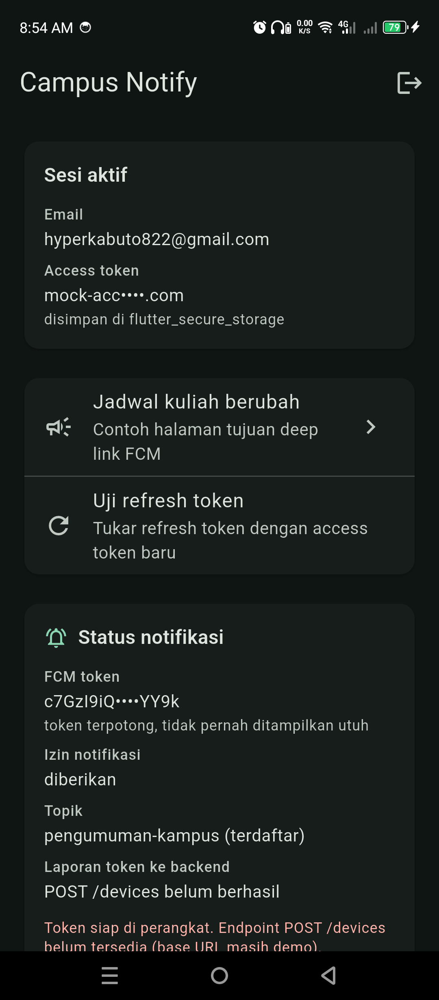
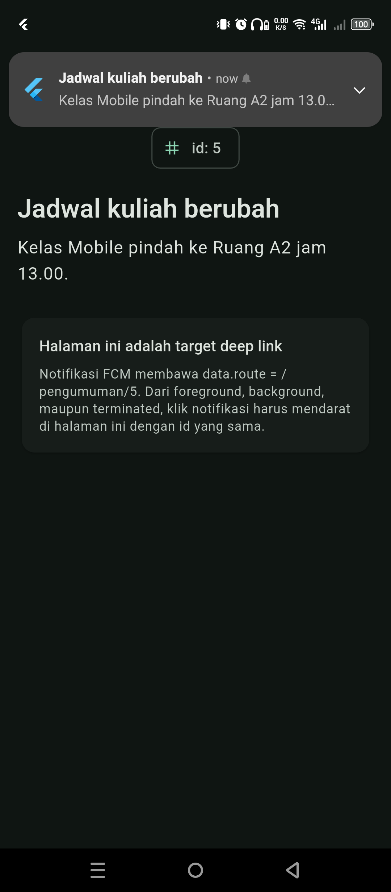
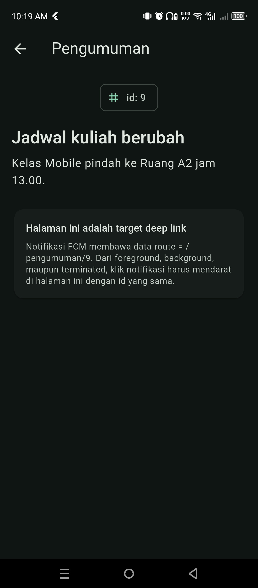
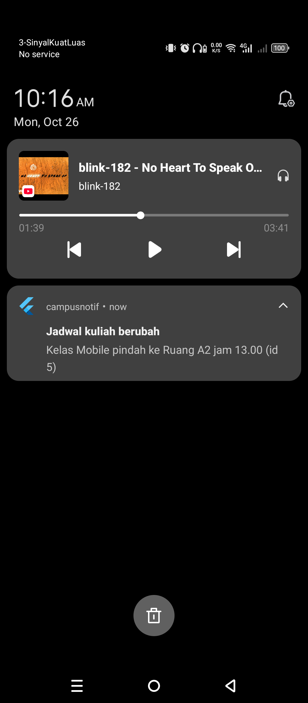
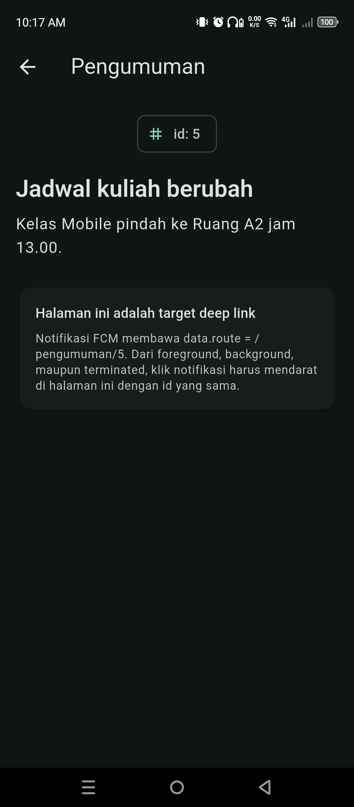
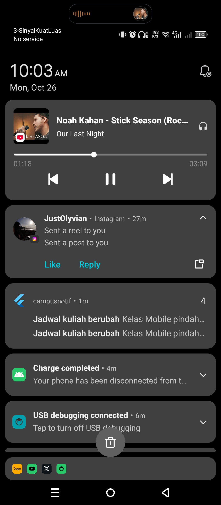
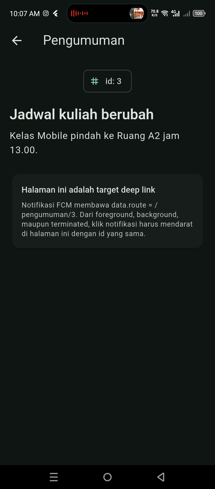

# Panduan pengguna

Panduan ini menjelaskan apa yang terlihat di layar dan apa artinya. Ditulis
untuk pengguna aplikasi dan penguji manual; tidak perlu memahami kode.

## 1. Tentang aplikasi

Campus Notify menampilkan pengumuman kampus lewat notifikasi. Notifikasi bisa
datang saat aplikasi sedang dibuka, sedang di belakang layar, atau bahkan sudah
ditutup — dan mengetuk notifikasi selalu membuka pengumuman yang dimaksud.

## 2. Sebelum mulai

| Kebutuhan | Keterangan |
|---|---|
| Perangkat Android | Dengan **Google Play Services** (emulator ber-Play Store atau HP fisik) |
| Izin notifikasi | Diminta saat aplikasi pertama kali dibuka; harus diizinkan |
| Akun | Mode praktikum: **email apa pun yang mengandung `@`** dan kata sandi minimal 6 karakter |

Bila izin notifikasi ditolak, aplikasi tetap bisa dipakai untuk login dan
membaca pengumuman, tetapi tidak akan menerima notifikasi. Izin bisa
diaktifkan lagi lewat Pengaturan Android → Aplikasi → Campus Notify →
Notifikasi.

## 3. Masuk (login)

Layar pertama yang muncul adalah form masuk:

| Kolom | Aturan |
|---|---|
| Email | Wajib diisi dan harus mengandung `@` |
| Kata sandi | Wajib diisi, minimal 6 karakter; bisa ditampilkan dengan ikon mata |

Cara masuk tergantung kesiapan Firebase, dan hal ini terlihat dari catatan kecil
di bawah tombol **Masuk**:

| Catatan di layar | Artinya |
|---|---|
| "Masuk memakai akun Firebase Authentication…" | Gunakan email & kata sandi akun yang terdaftar di Firebase Console |
| "Mode praktikum: Firebase belum dikonfigurasi…" | Aplikasi memakai akun simulasi: email apa pun yang mengandung `@`, kata sandi ≥ 6 karakter |

Pesan kesalahan yang mungkin muncul:

| Pesan | Arti |
|---|---|
| "Email wajib diisi" / "Format email tidak valid" | Kolom email belum benar |
| "Kata sandi wajib diisi" / "Minimal 6 karakter" | Kolom kata sandi belum benar |
| "Email atau kata sandi tidak valid" | Ditolak oleh layanan autentikasi |
| "Email belum terdaftar" / "Kata sandi salah" | Akun Firebase tidak cocok |
| "Terlalu banyak percobaan login. Coba lagi nanti." | Firebase membatasi percobaan; tunggu beberapa saat |
| "Tidak ada koneksi internet." | Perangkat sedang offline |
| "Sesi berakhir. Silakan login ulang." | Sesi sebelumnya tidak bisa dipulihkan |

Setelah berhasil masuk, aplikasi otomatis berpindah ke beranda. Bila aplikasi
ditutup lalu dibuka lagi, Anda tetap masuk selama sesi tersimpan — tidak perlu
login ulang.

## 4. Beranda

Beranda berisi dua kartu: **Sesi aktif** dan **Status notifikasi**, ditambah ikon
**lonceng** di kanan atas.

### Lonceng notifikasi

Ikon lonceng di kanan atas menampilkan angka kecil berisi jumlah notifikasi yang
belum dibaca. Angka itu sama dengan angka pada badge ikon aplikasi di layar
utama ponsel.

| Keadaan | Tampilan |
|---|---|
| Tidak ada notifikasi baru | Lonceng tanpa angka |
| Ada notifikasi baru | Lonceng dengan angka, mis. `3` |
| Lonceng diketuk | Halaman **Notifikasi** terbuka |

### Kartu "Sesi aktif"

| Baris | Arti |
|---|---|
| Email | Akun yang sedang masuk |
| Access token | Token dalam bentuk **terpotong**, mis. `mock-acc••••c.id`. Token utuh tidak pernah ditampilkan — ini disengaja |

### Kartu "Status notifikasi"

| Baris | Nilai yang mungkin | Arti |
|---|---|---|
| FCM token | `abcd1234••••wxyz` atau `-` | Token perangkat, selalu terpotong. `-` berarti belum diperoleh (biasanya karena tanpa Google Play Services) |
| Izin notifikasi | `diberikan` / `belum / ditolak` | Status izin di sistem |
| Topik | `pengumuman-kampus (terdaftar)` / `belum terdaftar` | Langganan siaran pengumuman |
| Laporan token ke backend | `POST /devices berhasil` / `belum berhasil` | Apakah server kampus sudah menerima token perangkat ini |
| Deep link terakhir | mis. `/pengumuman/5` | Halaman terakhir yang dibuka dari notifikasi |
| Teks merah (bila ada) | mis. "Izin notifikasi ditolak…" | Penjelasan mengapa sesuatu belum berjalan |

> Pada versi praktikum, baris **Laporan token ke backend** memang menunjukkan
> "belum berhasil" karena alamat server masih contoh. Notifikasi tetap bisa
> diterima karena dikirim lewat topik, bukan lewat server kampus.

## 5. Aksi di beranda

| Aksi | Cara | Hasil |
|---|---|---|
| Membuka pengumuman | Ketuk "Jadwal kuliah berubah" | Halaman `/pengumuman/3` terbuka |
| Menguji pembaruan sesi | Ketuk "Uji refresh token" | Pesan "Token diperbarui: …" (token terpotong) atau "Refresh ditolak. Sesi dihapus, silakan login ulang." |
| Menampilkan notifikasi uji | Ketuk "Tampilkan notifikasi uji" | Banner muncul tanpa menunggu kiriman dari server; berguna untuk memastikan izin dan saluran notifikasi bekerja |
| Keluar | Ikon di kanan atas | Perangkat dilepas dari backend, topik dihentikan, sesi dihapus, lalu kembali ke layar masuk |

## 6. Menerima notifikasi

Perilaku notifikasi berbeda tergantung keadaan aplikasi. Ketiganya sudah diuji
dan dibuktikan dengan tangkapan layar.

### 6.1 Aplikasi sedang terbuka (foreground)

Banner muncul di bagian atas layar walaupun aplikasi sedang dipakai.

Ketuk banner → aplikasi membuka halaman pengumuman sesuai isi notifikasi:

> Banner hanya tampil beberapa detik. Bila terlewat, pengumuman tetap bisa
> dibuka dari beranda.

### 6.2 Aplikasi di belakang layar (background)

Notifikasi muncul di panel notifikasi Android seperti biasa.

Ketuk notifikasi → aplikasi dibuka di pengumuman yang dimaksud:

### 6.3 Aplikasi sudah ditutup (terminated)

Notifikasi tetap masuk meskipun aplikasi sudah di-*swipe* dari daftar aplikasi
terakhir.

Ketuk notifikasi → aplikasi **dibuka dari nol** dan langsung mendarat di
pengumuman tersebut, bukan di beranda:

### Ringkasan

| Keadaan aplikasi | Yang terlihat | Setelah diketuk |
|---|---|---|
| Terbuka | Banner di atas layar | Pengumuman terbuka, aplikasi tetap di depan |
| Di belakang layar | Notifikasi di panel Android | Aplikasi ke depan, pengumuman terbuka |
| Ditutup | Notifikasi di panel Android | Aplikasi mulai dari awal, langsung ke pengumuman |

Pada halaman pengumuman, nomor `id` di bagian atas menunjukkan pengumuman mana
yang dibuka. Tombol kembali berfungsi walaupun aplikasi baru saja dimulai dari
notifikasi.

### 6.4 Suara notifikasi

Notifikasi berbunyi dengan nada khusus aplikasi (bukan nada bawaan ponsel).
Suara ini diatur oleh **saluran notifikasi** bernama **Pengumuman Kampus**.

| Keadaan | Suara |
|---|---|
| Nada dering normal | Nada kustom berbunyi sekali |
| Mode senyap / getar | Tidak berbunyi (mengikuti setelan ponsel) |
| Saluran "Pengumuman Kampus" dimatikan | Tidak berbunyi sampai dinyalakan lagi |

Bila ingin mengganti atau mematikan suara: **Pengaturan ponsel → Aplikasi →
Campus Notify → Notifikasi → Pengumuman Kampus**.

### 6.5 Daftar notifikasi (kotak masuk)

Ketuk ikon **lonceng** di beranda untuk membuka daftar notifikasi.

| Keadaan | Yang terlihat |
|---|---|
| Ada notifikasi baru | Daftar berisi judul, isi singkat, waktu ("5 mnt lalu"), dan tujuan halamannya |
| Belum ada notifikasi baru | Tulisan "Tidak ada notifikasi baru" |

Aturan pentingnya: **notifikasi yang dibaca akan hilang dari daftar.**

| Tindakan | Akibat |
|---|---|
| Ketuk satu notifikasi | Notifikasi dianggap dibaca → hilang dari daftar → halaman tujuannya terbuka |
| Ketuk ikon ✓✓ (tandai semua dibaca) | Seluruh daftar dikosongkan |
| Tarik daftar ke bawah | Daftar dimuat ulang dari penyimpanan |
| Mengetuk notifikasi dari panel Android | Notifikasi itu langsung dianggap dibaca, jadi tidak muncul lagi di daftar |

Jumlah entri di daftar selalu sama dengan angka pada lonceng dan pada badge ikon
aplikasi. Notifikasi yang masuk ketika aplikasi sedang terbuka juga ikut
tercatat, sehingga tombol **"Tampilkan notifikasi uji"** bisa dipakai untuk
melihat daftar, angka lonceng, dan suara sekaligus.

## 7. Bila notifikasi tidak muncul

| Yang dicek | Cara |
|---|---|
| Izin notifikasi | Beranda → baris "Izin notifikasi" harus `diberikan` |
| Token perangkat | Baris "FCM token" tidak boleh `-` |
| Langganan topik | Baris "Topik" harus `pengumuman-kampus (terdaftar)` |
| Mode jangan ganggu / senyap | Matikan sementara, lalu kirim notifikasi uji |
| Optimasi baterai | Beberapa perangkat menunda notifikasi; coba buka aplikasi lalu kirim ulang |
| Uji tanpa server | Ketuk "Tampilkan notifikasi uji" di beranda |

Bila notifikasi uji lokal muncul tetapi notifikasi dari server tidak, masalahnya
ada di sisi pengiriman (target/topik), bukan di perangkat.

Bila notifikasi muncul tetapi **tidak bersuara**, periksa:

| Yang dicek | Cara |
|---|---|
| Volume media/notifikasi | Naikkan volume notifikasi |
| Saluran "Pengumuman Kampus" | Pengaturan → Aplikasi → Campus Notify → Notifikasi; pastikan tidak dimatikan |
| Pengiriman dari server | Payload harus memakai `channel_id: pengumuman_v2`; channel lama tidak memakai suara kustom |

Bila **angka pada ikon aplikasi** tidak muncul, itu tergantung launcher. Badge
angka hanya bisa dipasang pada launcher yang mendukungnya (Samsung, Xiaomi/MIUI,
Oppo, Vivo, Huawei/Honor, Sony, dan beberapa lain). Launcher lain — termasuk
Pixel/stock Android dan Infinix XOS — hanya menampilkan **titik** yang berasal
dari notifikasi aktif, bukan angka. Angka pada ikon **lonceng di dalam aplikasi**
selalu akurat, apa pun launcher-nya.

## 8. Keamanan dan privasi

- Token akses dan token pembaruan disimpan di penyimpanan terenkripsi sistem
  (Android Keystore), bukan di berkas biasa.
- Token selalu ditampilkan dalam bentuk terpotong; token utuh tidak pernah
  muncul di layar maupun di log aplikasi.
- Saat keluar (logout), perangkat dilepas dari backend dan langganan topik
  dihentikan lebih dulu, lalu seluruh sesi dihapus dari perangkat.
- Bila sesi tidak bisa diperpanjang lagi, aplikasi otomatis mengeluarkan Anda
  dan meminta login ulang — ini perilaku yang benar, bukan kerusakan.

## 9. Pertanyaan yang sering muncul

**Apakah harus punya akun kampus?**
Pada mode praktikum, belum. Gunakan email apa pun yang mengandung `@` dan kata
sandi minimal 6 karakter.

**Kenapa "Laporan token ke backend" belum berhasil?**
Karena alamat server pada versi ini masih contoh. Notifikasi tetap diterima
lewat topik `pengumuman-kampus`.

**Kenapa token hanya terlihat sebagian?**
Agar tangkapan layar dan log tidak bisa dipakai orang lain untuk membajak sesi.

**Apakah notifikasi masuk saat HP terkunci?**
Ya, notifikasi ditampilkan sistem. Setelah dibuka, aplikasi mendarat di
pengumuman yang dimaksud.

**Kenapa saya diminta login ulang padahal baru saja masuk?**
Sesi tidak bisa diperpanjang (mis. token pembaruan ditolak server). Aplikasi
menghapus sesi lama agar tidak menyisakan data yang tidak valid.
